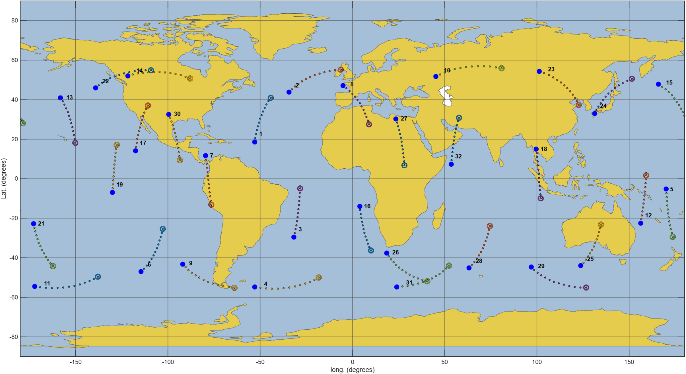
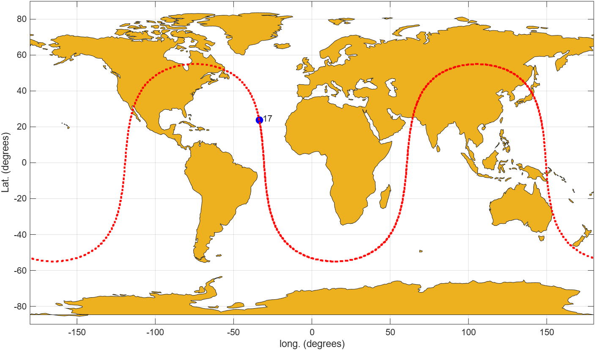
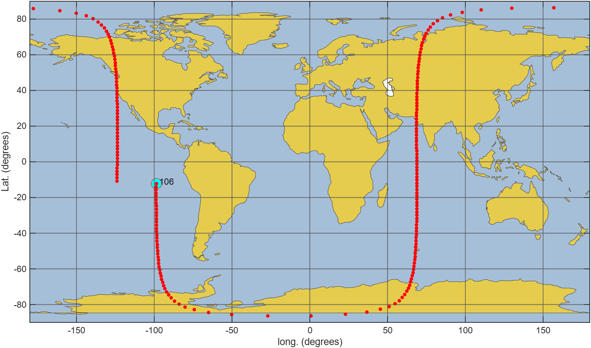
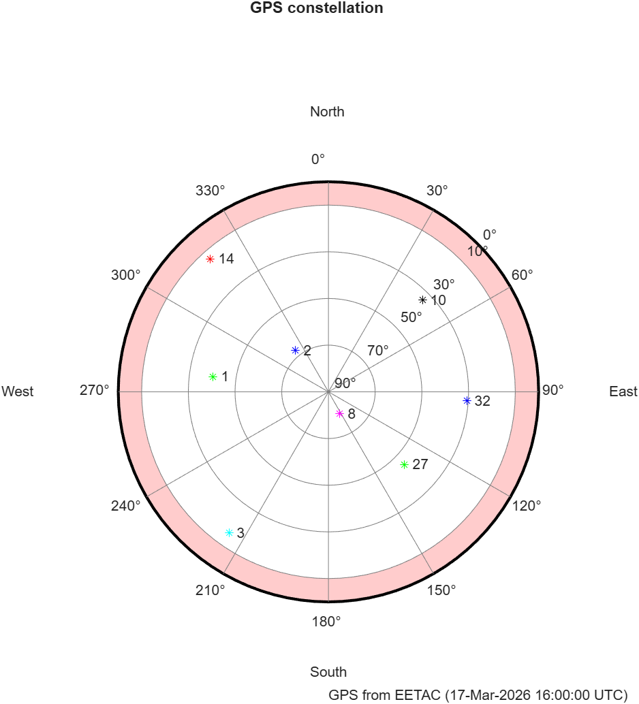
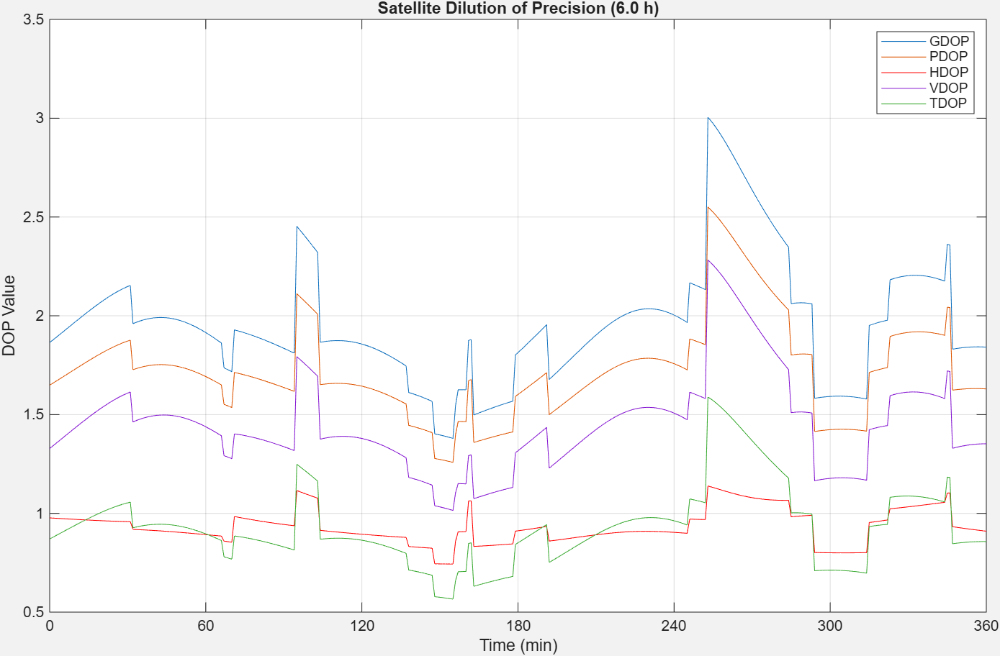

# GNSS Positioning Labs

MATLAB code from four satellite-navigation lab sessions at EETAC–UPC. It builds a small GPS toolkit step by step: from a single satellite orbit computed from the almanac to the receiver position computed from real pseudoranges.

  

<em>Ground tracks of the whole GPS constellation, computed from the almanac.</em>

## Labs

### Lab 1 — Satellite orbit and ground track (`lab1-satellite-orbit`)
- Reads the GPS almanac (YUMA format) and computes the satellite position over time: mean anomaly, Kepler's equation solved with Newton–Raphson, true anomaly, position in the orbital plane and conversion to ECEF.
- Computes the sub-satellite point and plots the ground track of one satellite.

### Lab 2 — Constellation and LEO ground tracks (`lab2-ground-tracks`)
- **GPS constellation:** propagates every satellite in the almanac and plots all the ground tracks together. The result was checked against the FAA reference plot.
- **Iridium NEXT:** the same model applied to a LEO satellite (Iridium 106) from its TLE elements, with the Greenwich sidereal angle for the Earth rotation. The result was checked against the SATCAT reference.

### Lab 3 — Satellite visibility (`lab3-visibility`)
- Converts the observer position (EETAC, Castelldefels) from LLA to ECEF (WGS-84).
- Computes the line of sight to every satellite, rotates it to the local NED frame and gets azimuth and elevation.
- Builds a sky plot with the satellites above a 10° elevation mask, checked against GNSS Mission Planning.

### Lab 4 — Dilution of precision and position solution (`lab4-dop-and-positioning`)
- **DOP:** builds the geometry matrix H from the visible satellites and computes GDOP, PDOP, HDOP, VDOP and TDOP over 24 h, checked against GNSS Mission Planning.
- **Iterative positioning:** solves the non-linear GPS navigation equations from real measured pseudoranges. The system is linearised around an initial guess (EETAC) and solved by least squares, iterating until the correction is below 10 m.

## How to run

Each folder is self-contained. Open it in MATLAB and run its `main*.m` script:

| Folder | Script |
|---|---|
| `lab1-satellite-orbit` | `main1.m`, `main3.m` |
| `lab2-ground-tracks/gps-constellation` | `main2.m` |
| `lab2-ground-tracks/iridium` | `main3.m` |
| `lab3-visibility` | `main4.m` |
| `lab4-dop-and-positioning/dop` | `main5.m` |
| `lab4-dop-and-positioning/iterative-positioning` | `main6.m` |

The almanac files used in the labs are included. If a script needs a different date, `almanac.m` downloads the almanac from CelesTrak.

## Credits

- Lab sessions of the air navigation course (NACC) at EETAC–UPC, spring 2026. Team: Gerard Artó and Andreu Bueno.
- The utility scripts for GPS time, almanac download, Julian date, world map and sky plot (`gpstime.m`, `almanac.m`, `JDfromUTC.m`, `plotworld.m`, `viewsat.m`) were provided with the lab material. The orbit, coordinate-conversion, DOP and positioning functions are our own work.
- Almanac data from [CelesTrak](https://celestrak.org/) and coastlines from Natural Earth (`world_110m.txt`).

## Author

Andreu Bueno Álvarez — Aerospace Systems Engineering, EETAC–UPC.
